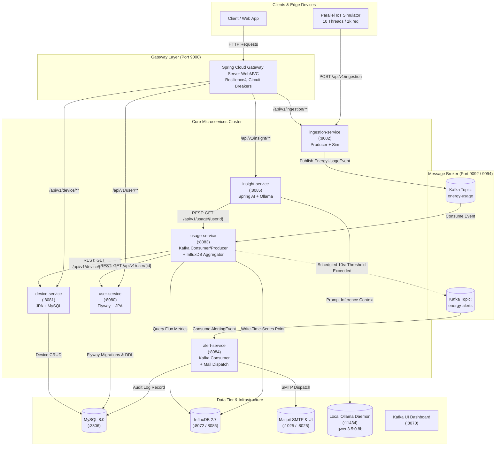

<div align="center">

# ⚡ Home Energy Tracker

### Cloud-Native Microservices Ecosystem for Real-Time IoT Energy Ingestion, High-Throughput Stream Processing, Automated Threshold Alerting & Generative AI Optimization Insights

[](https://openjdk.org/)
[](https://spring.io/projects/spring-boot)
[](https://spring.io/projects/spring-cloud)
[](https://kafka.apache.org/)
[](https://www.influxdata.com/)
[](https://www.mysql.com/)
[](https://spring.io/projects/spring-ai)
[](https://www.docker.com/)

<p align="center">
  <a href="#-system-overview">Overview</a> •
  <a href="#-architecture--data-flow">Architecture</a> •
  <a href="#-microservices-breakdown">Microservices</a> •
  <a href="#-technology-stack">Tech Stack</a> •
  <a href="#-infrastructure--ports">Infrastructure</a> •
  <a href="#-api-reference">API Reference</a> •
  <a href="#-getting-started">Getting Started</a> •
  <a href="#-observability--resilience">Observability</a>
</p>

---

</div>

## 📖 System Overview

**Home Energy Tracker** is an end-to-end, event-driven distributed microservices platform engineered to monitor, ingest, aggregate, analyze, and optimize household device energy consumption in real time.

### Key Capabilities

- **🚀 High-Throughput Telemetry Ingestion**: Ingests high-frequency device energy readings via asynchronous event streaming over **Apache Kafka** (KRaft mode).
- **⏱️ Time-Series Metric Storage**: Retains fine-grained, timestamped consumption points within **InfluxDB 2.7** using Flux queries for sub-minute downsampling and multi-day aggregation.
- **🛡️ Intelligent Threshold Monitoring & Dispatch**: Runs scheduled cron aggregations (every 10s) across rolling windows, compares user consumption against configured alerting thresholds, and triggers automated email dispatch notifications via **Mailpit** and **Spring Mail**.
- **🤖 On-Device GenAI Optimization (Spring AI + Ollama)**: Bridges aggregated usage telemetry with local LLMs (e.g., `qwen3.5:0.8b` / `llama3`) via **Spring AI** to generate actionable, personalized energy-saving insights and usage digests without sending private data to external APIs.
- **⚡ Fault-Tolerant API Gateway**: Unified reverse-proxy entry point based on **Spring Cloud Gateway Server WebMVC** integrated with **Resilience4j Circuit Breakers**, routing requests with automatic fallback isolation.
- **🔄 Built-In Multi-Threaded IoT Load Simulator**: Emulates hundreds of smart IoT energy meters concurrently using bounded thread pools (`ExecutorService`) pushing synthetic telemetry.

---

## 🏗️ Architecture & Data Flow



---

## 🧩 Microservices Breakdown

| Service | Port | Primary Responsibilities | Data Store / Integration |
| :--- | :---: | :--- | :--- |
| **[`api-gateway`](file:///c:/Users/seghi/Desktop/Projects/home-energy-tracker/api-gateway)** | `9000` | Single entry point, path routing, unified ingress, Resilience4j circuit breakers, health indicators, and degraded graceful fallbacks. | Actuator, Spring Cloud Gateway WebMVC |
| **[`user-service`](file:///c:/Users/seghi/Desktop/Projects/home-energy-tracker/user-service)** | `8080` | Manages user master records, notification settings, alert thresholds (`energyAlertingThreshold`), and profile CRUD. Houses Flyway baseline migrations (`V1`, `V2`, `V3`). | MySQL (`user` table), Flyway, Spring Data JPA |
| **[`device-service`](file:///c:/Users/seghi/Desktop/Projects/home-energy-tracker/device-service)** | `8081` | Manages smart meters/appliances, device types (HEATING, COOLING, LIGHTING, EV, etc.), location zones, and user-to-device ownership mappings. | MySQL (`device` table), Spring Data JPA |
| **[`ingestion-service`](file:///c:/Users/seghi/Desktop/Projects/home-energy-tracker/ingestion-service)** | `8082` | High-speed ingestion REST API. Publishes `EnergyUsageEvent` to Kafka. Includes `ContinuousDataSimulator` and `ParallelDataSimulator` for stress & load testing. | Apache Kafka (`energy-usage` topic) |
| **[`usage-service`](file:///c:/Users/seghi/Desktop/Projects/home-energy-tracker/usage-service)** | `8083` | Consumes raw telemetry, persists time-series points to InfluxDB. Periodically evaluates hourly consumption vs. user thresholds (`@Scheduled`), publishes `AlertingEvent` to Kafka, and serves historic aggregations. | InfluxDB 2.7, Apache Kafka (`energy-usage`, `energy-alerts`) |
| **[`alert-service`](file:///c:/Users/seghi/Desktop/Projects/home-energy-tracker/alert-service)** | `8084` | Consumes `energy-alerts` events, builds notification templates, sends alert emails via SMTP (Mailpit), and records audit history in MySQL. | Mailpit SMTP (`1025`), MySQL (`alert` table), Apache Kafka |
| **[`insight-service`](file:///c:/Users/seghi/Desktop/Projects/home-energy-tracker/insight-service)** | `8085` | AI advisory engine. Queries aggregated telemetry from `usage-service`, feeds prompt contexts to local Ollama LLMs (`qwen3.5:0.8b`), and generates natural language saving recommendations. | Ollama Local LLM API (`11434`), Spring AI |

---

## 💻 Technology Stack

### Backend & Frameworks
- **Language**: Java 21+ / Java 27 (OpenJDK preview support configured)
- **Framework**: Spring Boot 4.1.2 & Spring Framework
- **Cloud & Edge**: Spring Cloud Gateway Server WebMVC (`2025.1.4`), Spring Cloud Circuit Breaker
- **Fault Tolerance**: Resilience4j (Sliding-window circuit breaker with count-based fallback)
- **AI Integration**: Spring AI BOM (`2.0.1`) with `spring-ai-starter-model-ollama`
- **Data Persistence**: Spring Data JPA / Hibernate, Flyway Database Migrations (`flyway-mysql`)
- **AOP & Observability**: AspectJ runtime (`@Aspect`) for execution time measurement & method audit logging
- **API Documentation**: SpringDoc OpenAPI UI / Swagger 3 (`springdoc-openapi-starter-webmvc-ui:3.2.0`)
- **Utility**: Project Lombok, Jackson JSON, Spring Boot Actuator

### Messaging & Storage
- **Message Broker**: Apache Kafka (KRaft mode — zero Zookeeper dependency)
- **Time-Series Database**: InfluxDB 2.7 (Flux Query Language, Nano/Milli precision write APIs)
- **Relational Database**: MySQL 8.0 (InnoDB, UTF-8 Mb4)
- **Email & SMTP**: Axllent Mailpit (Mock SMTP server & HTML inspection UI)
- **Model Inference**: Ollama (`qwen3.5:0.8b` / customizable LLM models)

---

## 🐳 Infrastructure & Ports

All core infrastructure dependencies are containerized through [`docker-compose.yml`](file:///c:/Users/seghi/Desktop/Projects/home-energy-tracker/docker-compose.yml):

| Container Name | Image | Host Port | Internal Port | Description |
| :--- | :--- | :---: | :---: | :--- |
| `mysql` | `mysql:latest` | `3306` | `3306` | Relational storage for users, devices, and alert history |
| `kafka` | `apache/kafka:latest` | `9094` | `9092` | Apache Kafka in KRaft mode (`localhost:9094` for host services) |
| `kafka-ui` | `ghcr.io/kafbat/kafka-ui:latest` | `8070` | `8080` | Web console for viewing topics, consumer groups, and messages |
| `influxdb` | `influxdb:2.7` | `8072` | `8086` | Time-series database storing high-speed consumption data |
| `mailpit` | `axllent/mailpit:latest` | `8025` / `1025` | `8025` / `1025` | Mailpit Web UI (`:8025`) and SMTP listener (`:1025`) |

---

## 📡 API Reference & Routing Matrix

Requests can be issued directly to services or routed via the **API Gateway** (`http://localhost:9000`).

### 1. User Service (`/api/v1/user`)
- `POST /api/v1/user` — Create a new user profile with alert thresholds.
- `GET /api/v1/user/{id}` — Retrieve user profile by ID.
- `PUT /api/v1/user/{id}` — Update user email, address, alerting status, or threshold.
- `DELETE /api/v1/user/{id}` — Delete user (cascades to devices).

### 2. Device Service (`/api/v1/device`)
- `POST /api/v1/device/create` — Register a new device with assigned `userId`.
- `GET /api/v1/device/{id}` — Retrieve device metadata by ID.
- `GET /api/v1/device/user/{userId}` — List all registered devices owned by a user.
- `PUT /api/v1/device/{id}` — Update device specifications.
- `DELETE /api/v1/device/{id}` — Remove a device.

### 3. Ingestion Service (`/api/v1/ingestion`)
- `POST /api/v1/ingestion` — Ingest a single energy reading:
  ```json
  {
    "deviceId": 1,
    "energyConsumed": 1.45,
    "timestamp": "2026-10-28T09:00:00Z"
  }
  ```

### 4. Usage Service (`/api/v1/usage`)
- `GET /api/v1/usage/{userId}?days=3` — Retrieve user's aggregated consumption per device over a rolling window of $X$ days (defaults to 3 days).

### 5. Insight Service (`/api/v1/insight`)
- `GET /api/v1/insight/overview/{userId}` — Generates an AI-powered 3-day holistic energy consumption summary with recommendations.
- `GET /api/v1/insight/saving-tips/{userId}` — Generates AI actionable energy-saving tips based on the past 24 hours of device consumption.

---

## 🚦 Getting Started

### Prerequisites
- **Docker & Docker Compose** (v20+)
- **Java Development Kit (JDK 21 or 27)**
- **Maven 3.9+** (or use the included `./mvnw` wrappers)
- **Ollama** installed locally (if running `insight-service`)
  ```bash
  ollama pull qwen3.5:0.8b
  ollama run qwen3.5:0.8b
  ```

---

### Step 1: Start Infrastructure Containers

From the repository root, start MySQL, Kafka KRaft, Kafka UI, InfluxDB, and Mailpit:

```bash
docker-compose up -d
```

Verify that all containers are healthy:
```bash
docker-compose ps
```

- **Kafka UI**: [http://localhost:8070](http://localhost:8070)
- **InfluxDB UI**: [http://localhost:8072](http://localhost:8072) (User: `root`, Pass: `password`, Org: `leetjourney`, Bucket: `usage-bucket`)
- **Mailpit Web UI**: [http://localhost:8025](http://localhost:8025)

---

### Step 2: Build & Start Services

You can start each service using the provided Maven wrapper. It is recommended to boot them in the following order:

```bash
# 1. User Service (Applies Flyway migrations to MySQL)
cd user-service && ./mvnw spring-boot:run

# 2. Device Service
cd device-service && ./mvnw spring-boot:run

# 3. Usage Service (Subscribes to Kafka & connects to InfluxDB)
cd usage-service && ./mvnw spring-boot:run

# 4. Alert Service (Subscribes to Kafka & connects to Mailpit)
cd alert-service && ./mvnw spring-boot:run

# 5. Ingestion Service (Kafka producer & IoT simulator)
cd ingestion-service && ./mvnw spring-boot:run

# 6. Insight Service (Spring AI + Ollama)
cd insight-service && ./mvnw spring-boot:run

# 7. API Gateway (Reverse proxy & circuit breakers)
cd api-gateway && ./mvnw spring-boot:run
```

*(On Windows PowerShell, use `.\mvnw.cmd spring-boot:run`)*

---

### Step 3: End-to-End Simulation & Verification

1. **Create a User**:
   ```bash
   curl -X POST http://localhost:9000/api/v1/user \
     -H "Content-Type: application/json" \
     -d '{"name":"Alex","surname":"Doe","email":"alex@example.com","address":"123 Solar Way","alerting":true,"energyAlertingThreshold":5.0}'
   ```
2. **Register Devices for the User**:
   ```bash
   curl -X POST http://localhost:9000/api/v1/device/create \
     -H "Content-Type: application/json" \
     -d '{"name":"Living Room AC","type":"COOLING","location":"Living Room","userId":1}'
   ```
3. **Simulate Data Ingestion**:
   Send telemetry manually or observe `ParallelDataSimulator` generating readings:
   ```bash
   curl -X POST http://localhost:9000/api/v1/ingestion \
     -H "Content-Type: application/json" \
     -d '{"deviceId":1,"energyConsumed":6.2,"timestamp":"2026-10-28T09:30:00Z"}'
   ```
4. **Inspect Automated Alerts**:
   Open **Mailpit** at [http://localhost:8025](http://localhost:8025). Within 10 seconds, `usage-service` identifies that device consumption has exceeded Alex's threshold (6.2 > 5.0 kWh), dispatches a Kafka event, and `alert-service` delivers the alert email.
5. **Request AI Insights**:
   ```bash
   curl http://localhost:9000/api/v1/insight/saving-tips/1
   ```

---

## 🛡️ Observability, Resilience & AOP

- **Resilience4j Circuit Breaker**: Guarding downstream services in `api-gateway`. Configured with a sliding count window of 8 calls and a 20% failure threshold. Trips to `503 Service Unavailable` with friendly fallback handlers during outages.
- **Spring Actuator**: Health metrics and circuit breaker telemetry exposed via `/actuator/health`, `/actuator/metrics`, and `/actuator/circuitbreakers`.
- **Custom AspectJ Logging & Profiling**:
  - `ExecutionTimeAspect`: Transparently tracks nano/millisecond execution latency on controller handlers.
  - `LoggingAspect`: Logs incoming method signatures, parameter payloads, and return objects across service beans.
- **Interactive Swagger / OpenAPI UI**:
  Each service and gateway provides interactive OpenAPI documentation accessible under `/swagger-ui.html`.

---

## 📂 Project Structure

```text
home-energy-tracker/
├── api-gateway/            # Spring Cloud Gateway Server WebMVC (Port 9000)
├── user-service/           # User lifecycle, settings & Flyway DDL (Port 8080)
├── device-service/         # IoT device inventory & user associations (Port 8081)
├── ingestion-service/      # High-speed telemetry ingestion & load simulator (Port 8082)
├── usage-service/          # InfluxDB writer, Kafka consumer, threshold engine (Port 8083)
├── alert-service/          # Alert listener, Mailpit SMTP notification engine (Port 8084)
├── insight-service/        # Spring AI + Ollama LLM analytics engine (Port 8085)
├── docker/
│   ├── mysql/init.sql      # Database initialization script
│   └── kafka_data/         # Persistent Kafka KRaft logs
├── docker-compose.yml      # Multi-container orchestration (MySQL, Kafka, InfluxDB, Mailpit, Kafka-UI)
└── README.md               # SOTA Project Documentation
```

---

<div align="center">
  <sub>Built with ❤️ using Spring Boot, Apache Kafka, InfluxDB & Spring AI</sub>
</div>
